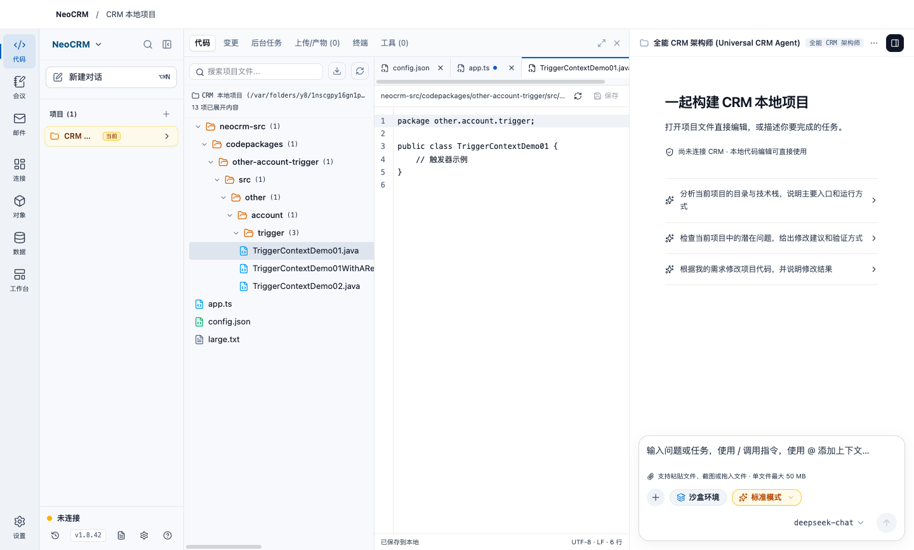

# 代码工作区使用说明

本说明对应在 v1.8.42 基础上开发的前台调整，尚未发布为安装包。界面沿用 Electron、React 和 TypeScript，不需要迁移项目语言或后端服务。



图中为界面测试的临时示例项目。

## 应用入口

左侧应用栏提供代码、会议、邮件、CRM 连接器、对象、数据与工作台入口。代码区保留项目列表、会话历史、角色切换、后台智能体与设置。会议和邮件使用各自的完整工作区，不再占用代码项目侧栏。

首次进入会议或邮件时加载对应界面；访问后保留页面状态，切换应用不会主动卸载会议录音界面、邮件草稿或 AI 对话。退出程序前仍需结束录音并保存文件。

## 打开和编辑项目

1. 点击“代码”，在项目列表右上角点击“＋”，关联本地项目文件夹。
2. 双击项目名称切换当前工作项目。在代码区左侧展开文件目录，或使用目录搜索查找文件。
3. 点击文件打开编辑标签。内置编辑器提供行号、搜索、撤销、缩进，以及 JavaScript、TypeScript、JSX、JSON、SQL 和 Markdown 语法高亮。其他 UTF-8 文本可按纯文本编辑。
4. 点击“保存”，或按 macOS 的 `⌘S`、Windows/Linux 的 `Ctrl+S` 保存到本地。标签上的圆点表示存在未保存修改。

切换标签会保留草稿和撤销记录；切换项目、应用或收起代码区，也会保留本次运行期间的文件草稿。关闭未保存文件或退出程序时需确认是否放弃修改；普通关闭窗口仍按原有机制隐藏或最小化，保留会话。草稿不提供崩溃后恢复，请及时保存。

文件保存保留 UTF-8 BOM（如原文件存在）、LF/CRLF 换行方式和普通权限位；混合换行的文件在编辑后会统一为状态栏显示的换行方式。

## 与 AI 协作

代码编辑器与 AI 对话并排显示。可以在目录文件的操作菜单中引用文件到对话，也可通过输入框的附件入口添加上下文。

在输入框输入 `@` 和技能名称或关键词，可在候选列表中选择已启用且当前有权限使用的技能，也可用方向键和 Enter 或 Tab 选择。选中的技能显示为“本次”标签，可在发送前移除；发送后仅用于该条消息，并在消息中保留引用标记。已有文件和业务对象的 `@` 引用仍可使用。技能说明会占用模型上下文，受保护技能仍需满足原有权限和授权条件。

如果 AI 或其他程序修改了已经打开的文件，保存时会检查磁盘版本。发生冲突时会拒绝覆盖并保留当前草稿。先复制需要保留的修改，再点击“重新读取磁盘文件”查看新版本并合并。重新读取会替换当前草稿；已有未保存内容时需要确认。

代码区顶部保留“变更”“终端”和“工具”入口。后台任务仍可通过输入框的 `/jobs` 查看，消息中的“查看所有产物”可打开产物列表；产物扫描和任务刷新只在对应页面打开时触发。终端执行的命令仍会对所选项目产生实际影响。

## 布局与文件限制

- 拖动代码区与 AI 对话之间的分隔线调整宽度；也可聚焦分隔线后用左右方向键调整。窄窗口会自动改为上下布局。
- 文件目录默认宽度为 300px。拖动目录与编辑器之间的分隔线可调整宽度，宽度会保存在本机；双击分隔线恢复默认。也可聚焦后按左右方向键调整。深层目录和长文件名保留完整文本，可横向滚动查看，悬停时显示完整相对路径。
- `⌘B` / `Ctrl+B` 折叠或展开项目侧栏。代码区右上角按钮可扩大或收起代码区；收起不会丢弃草稿。
- 支持已有的四种界面主题，在应用设置中切换。
- 内置编辑器支持不超过 2 MiB 的 UTF-8 文本。大文件、二进制和其他编码通过“系统应用打开”处理；不会截断后写回原文件。
- 编辑范围限于已关联项目中的已有文件。指向项目外部的符号链接无法通过内置编辑器读写。

## 会议与邮件

会议入口复用 v1.8.42 已有的录音、导入、转写、会议纪要、行动项和导出功能，默认使用会议总结视图。转写和 AI 总结仍需配置对应模型与音频服务。

邮件入口保留已有的账户、收发、草稿和 AI 助手功能。首次打开后，原有自动收取机制会继续按账户设置运行。

本次调整改善应用分区和代码操作体验，不代表高负载卡退问题已彻底解决；后台结果存储、模型上下文与长期运行仍需单独进行压力验证。

## 开发验证

```sh
npm run build
node scripts/test-project-editor.mjs
node scripts/test-code-workspace-ui.mjs --screenshots
```

界面测试使用临时项目、隔离的 Electron 用户数据和模拟服务，不连接真实租户、邮箱或模型。`--screenshots` 将截图保存到系统临时目录的 `neocrm-workspace-qa` 文件夹。
