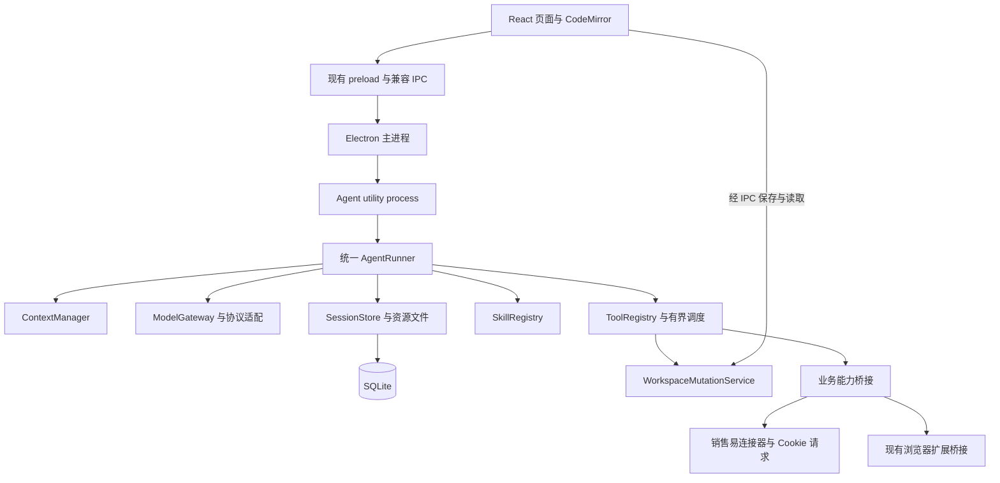

# 参照 OpenCode 的 Agent 核心改造方案

评审日期：2026-11-11。状态：P0/P1 公共模型网关和统一 Agent 循环已落地；P2 文件与技能第二轮完成；P3 SQLite 存储、旧数据迁移和会话按需加载已接入；P4 模型协议流已迁入 Electron utility process，CRM/浏览器/文件工具仍通过主进程原有受控入口。

## 1. 建议与决策边界

建议保留 Electron、React、TypeScript 和 CodeMirror，替换目前集中在 `aiService.ts` 中的执行核心。优先试用 OpenCode 的独立模型适配包，参照其执行循环、上下文检查点、技能指令和文件修改机制实现我们的业务运行时。

这次应当调整的是执行架构、存储和工具契约。前端框架和编辑器组件不是本次发现的主要问题来源。把 React 换成 Solid，或把 Electron 换成另一种桌面壳，不能直接消除协议分支、重复技能注入、同步历史读写和上下文超限。

本方案交付源码证据、可运行原型、改造边界和验收标准。整套运行时迁移、历史数据迁移及发布需按下面的阶段实施；本文中的目标不代表当前版本已经实现。

## 2. 本次实际核对的版本

| 项目 | 核对基线 | 说明 |
| --- | --- | --- |
| 本项目 | `package.json` 为 `1.8.50`，包含当前工作树的未提交修复 | 对照时 `aiService.ts` 为 4,728 行；现有上下文及参数恢复修复需保留 |
| OpenCode 源码 | `anomalyco/opencode` 的 `dev` 提交 `e56eff2bc01649b3aa21224876b8874e77dea4b0` | 以这个提交固定证据，不把开发分支的包版本字段当作发版证明 |
| 原型依赖 | npm `@opencode/ai@2.2.7`，精确安装 | 与开发分支源码分别核对；原型验证的是发布包 |
| 原型环境 | macOS，Node `v24.21.0`、Node `v20.20.2`、Electron `44.7.0` | 本地已验证构建入口；Windows 安装包、真实模型账户仍由 CI/P0 后续验证 |

上游当前源码已拆成 `packages/core`、`packages/ai`、`packages/server` 等模块。本次结论来自这些源码，不沿用早期 `packages/opencode/src/session/processor.ts` 的目录和实现描述。

源码及 npm 包声明 MIT 许可。直接迁入源码时应保留对应版权和许可，并单独核对实际引入的依赖许可。[OC1、OC2、OC3]

## 3. 对照结果

| 链路 | 我们当前实现 | 上游已核对的机制 | 建议落点 |
| --- | --- | --- | --- |
| 执行循环 | OpenAI 兼容与 Gemini 原生各有一套循环，工具、重试和整理逻辑容易分叉 | `runner/llm.ts` 负责步骤策略，`runner/step.ts` 负责一次流式执行；协议在 AI 包中处理 [OC4、OC5] | 一个 `AgentRunner`，所有协议转换成相同事件 |
| 模型调用 | 主会话、会议总结等入口有独立请求处理；支持范围和错误提示不完全一致 | AI 包有协议、厂商路由及 Promise/AsyncIterable 入口 [OC3、OC6] | 共用模型网关；普通文本调用和工具循环使用不同上层调用方式 |
| 上下文 | 字符估算、工具精简、历史摘要及上游限额学习已存在；原生协议恢复能力不一致 | 使用已报告用量与之后新增内容估算，整理在步骤边界触发；摘要请求也有缩减策略 [OC7] | 将上下文管理变成独立服务，覆盖当前轮的工具结果 |
| 技能 | 已有按需读取资源，但角色、激活技能、显式引用等仍有多个注入入口 | 目录先提供 ID、名称、描述；正文由技能工具或显式引用提供 [OC8、OC9] | 一个技能注册表、一个加载入口、可追踪的加载状态 |
| 代码修改 | GUI 编辑器已有哈希校验、串行保存和临时文件替换；AI 的 write/edit/str_replace 仍直接同步写文件 | 文件修改共享路径锁；edit 要求唯一匹配并处理 CRLF、BOM，返回差异信息 [OC10、OC11] | GUI 与 Agent 共同使用 `WorkspaceMutationService` |
| 会话持久化 | 同步读取所有会话 JSON，保存时重写整个数组 | SQLite 按会话、消息、片段存储，消息有顺序和索引 [OC12] | 独立存储进程内分页查询、增量提交 |
| 桌面运行 | `electron/main.ts` 直接实例化 AI 服务和多个业务服务 | 当前桌面端也是 Electron，通过后台服务连接运行时 [OC2、OC13] | 将 Agent 执行移出主进程，先使用 Electron utility process |

本地主要证据入口：

- `electron/main.ts`：`new AiService` 及 `ai:*` IPC。
- `electron/services/aiService.ts`：`runChatStream`、`runGeminiNativeStream`、`compactSession`、`executeUnifiedTool`、`getSessions`、`saveSession`。
- `electron/services/modelContext.ts`：预算、估算、工具调用配对与历史精简。
- `electron/services/projectEditorService.ts`：GUI 文件修订校验与保存队列。
- `electron/services/dshToolService.ts`：`writeFile`、`editFile`、`strReplaceEditor`。
- `electron/services/meetingModelClient.ts`：独立的多协议文本请求。

## 4. 上下文管理应怎样调整

### 4.1 统一预算，不只调低触发百分比

预算同时覆盖系统指令、技能正文、工具 Schema、历史摘要、近期消息、本轮工具结果以及媒体。一个会话内多次请求的累计用量，不能当作下一次请求的上下文大小。

建议采用以下契约，分别记录每种限额的来源：

```text
可用输入 = min(模型/网关最大输入, 上下文窗口 - 本次预留输出) - 安全余量
请求输入 = 最近可复用的真实输入基线 + 该基线之后的新增内容估算
```

未提供某项限额时跳过该项约束，不能将未知当成无限，也不能把“最大输入”再次无条件扣减输出。未知容量采用保守配置并明确标识。缓存命中 token 在不同协议中可能已包含在 input 中，适配层必须先统一口径，避免重复相加。

OpenCode 的 `estimatePrompt` 提供真实用量加新增估算的参考；模型、指令、工具定义或协议变化后，需要重建或校正基线。不能直接复制某一厂商的 token 字段相加方式。[OC7]

### 4.2 每次模型请求前检查，工具结果先限量

一次用户任务可能经历几十次工具调用，不能只在用户点击发送时检查。每次模型请求前重新编译上下文；大工具结果在进入上下文前保存为本地资源，模型只收到摘要、截断提示和继续读取入口。

上游 `ToolOutput` 的默认文本上限为 2,000 行或 50 KiB，超出部分保存到文件。[OC14] 我们应按剩余预算和工具类型配置上限；浏览器 DOM、搜索结果、实体元数据和终端日志不适合共用一个固定字符数。图片还需独立限制数量、尺寸和请求字节数。

原文保存在资源库或原始历史中。模型读取视图可以精简，但必须保留调用 ID、状态和资源引用；不能留下缺少结果的工具调用。

### 4.3 摘要覆盖当前轮，摘要请求自身也要能缩小

检查点输入应是统一消息存储中的一个已完成前缀，包含当前轮已经完成的工具交换。正在执行的调用留在尾部。摘要成功且前缀仍匹配后，才提交新的检查点。

上游摘要请求遇到容量拒绝会按阶梯缩小；支持保留最近内容，也有可选的后台预计算，当前源码默认关闭预计算。[OC7] 我们先实现前台可取消整理，后台预计算在费用与并发可控后再启用。

建议保留“目标、约束、决策、已完成事项、待办、关键文件、已完成工具引用”。压缩后的技能大正文可以卸载，但记录技能 ID、版本与已读资源；继续执行前恢复必要指令。不要在恢复时重新注入全部技能。

### 4.4 超限恢复必须有统一终点

区分上下文超限、请求字节过大、输出截断、限流和网络中断。仅对上下文错误启动整理；当前请求的不可精简部分已超限时，直接解释是附件、技能、工具定义还是当前输入过大。

现有工作树的学习限额和有限重试继续保留，迁入统一 `ContextManager`。学习值应区分“上游明确报告”与“本地推断”，带时间、配置指纹和重置入口；推断值先作为临时降级值，不能永久无声地下调。上下文重试计数以一次任务为范围，整理后请求必须实际缩小。

OpenCode 可以提供恢复机制的参考，但不会自动识别所有第三方网关的真实限额，也不能保证摘要完全无损。我们需要用实际连接器和模型网关做验证。

## 5. 技能与模型调用的目标契约

技能注册表统一维护 `id / name / description / version / source / enabled / resourceIndex`。保留受保护技能的授权、解密和资源边界，目录查询不能绕过授权检查。

用户输入引用、自动匹配和模型主动加载，都进入同一 `SkillRegistry.load`。同一个上下文窗口内按 ID 与版本去重；在上下文整理、技能更新或禁用后重新核对状态。目录可提前加载，正文在有明确用途时读取，参考文档按资源分页。

上游技能工具的入参是 `id`，我们现有工具使用 `name`。迁移时做边界映射以兼容历史记录，不能直接替换 Schema 导致旧调用失效。技能加载仍然只是取得指令，真正的文件修改、接口调用或部署应产生独立工具记录。[OC8、OC9]

模型层建议先封装 `@opencode/ai@2.2.7`，而不是把它的类型散落进业务页面。它已有 Promise 接口，可以在边界内保留 Effect 依赖；本项目不必整体采用 Effect。[OC3] WorkBuddy、Cookie 连接器、浏览器桥接和受保护技能则需要自己的适配器。

统一事件至少包含文本增量、推理增量、工具参数增量、完整工具调用、用量、结束原因和结构化错误。只有参数完整且通过 Schema 校验的调用才能执行。错误作为对应工具结果返回，由模型进行有限次纠正；不靠补括号或正则猜测缺失参数。

**生产中不直接使用上游通用 `ai.loop` 作为最终调度器。** 该包的工具循环可用于原型，但其 `runTools` 使用不设上限的并发。我们仍需要自己的工具分类、队列、取消和资源预算；同文件写入串行、终端任务有限并发，父任务等待子任务时不能占住唯一执行槽。[OC15]

## 6. 代码编辑的目标行为

CodeMirror 继续负责输入、语法高亮和编辑状态。真正需要统一的是 GUI、AI 和项目文件之间的修改契约：

1. 读取返回内容与 revision；修改调用携带读取时的 revision。
2. `write`、`edit`、`str_replace_editor` 以及 GUI 保存走同一服务，按规范化真实路径串行。
3. 默认替换必须唯一匹配，多处匹配时要求增加上下文或明确全部替换；空目标、无变化及不匹配均返回可恢复错误。
4. 保留现有 GUI 的冲突检测，补齐 AI 路径的 revision 校验；共同使用临时文件替换、大小和编码限制，保留 CRLF/BOM。
5. 返回真实 diff 和新 revision；编辑器收到变更事件后，干净文档可刷新，有未保存草稿则显示合并提示。
6. 多文件修改先验证全部候选，再逐文件提交；失败报告已修改和未修改清单。跨文件原子事务及自动回滚必须另做设计，不能声称天然支持。

OpenCode 当前源码的路径锁只保护同进程内协作修改，外部程序写入仍可能竞争；部分 LSP、撤销与多文件回滚功能还标有 TODO。[OC10、OC11] 因此不能把“接入 OpenCode 编辑工具”描述成已经拥有完整 IDE。LSP 和更换编辑器组件不列为第一阶段前置条件。

## 7. 目标架构与进程边界



图中 UI 到文件服务是逻辑调用，实际仍通过 preload、主进程和运行时 RPC，不给渲染层文件系统权限。

`aiService.ts` 逐步退为兼容门面。建议新增模块边界为 `agent/runner`、`agent/context`、`agent/modelGateway`、`agent/skillRegistry`、`agent/toolRegistry`、`agent/sessionRepository`，对外复用现有会话 ID 和流事件。

主进程保留窗口、通知、系统对话框和凭据管理。运行时通过按调用授权的能力桥接访问 CRM 与浏览器；仅传需要的字段，不复制整个业务服务及登录会话。文件修改统一放在运行时，GUI 也调用相同服务。

运行时崩溃后允许重启，界面保留。无法确定是否已经完成的写入、上传或部署标为“执行结果待核对”，通过回读判断，禁止无条件自动重放。进程隔离减少故障牵连，但不能代替内存上限、缓存回收和总并发限制，也不能单凭架构图断言解决 Windows 卡退。

SQLite 存储只加载会话列表摘要和当前消息页，大工具结果、图片保存为独立资源。驱动选择需要在目标 Electron 版本中验证，再决定使用可用的内置能力或有对应 ABI 构建的驱动；不能仅凭当前命令行 Node 的支持情况确定。

## 8. 三条路线与成本估算

当前目标已明确为：保留 NeoCRM Electron 外壳、左侧项目/会话导航和业务入口，只替换 AI/代码工作区中央对话 UI 与 Agent/编辑能力。上游 app 的 workspace-only 集成和能力边界见 [OpenCode 对话工作区集成](opencode-workspace-integration.md)；不迁移整套桌面壳。

以下是按熟悉本仓库的一名工程师估计的人日，包含功能回归，属于工作量范围而非交付承诺；未包含重新设计整个 UI、外部审批等待或新的模型厂商接入。路线互为替代，不能相加。

| 路线 | 做法 | 估计工作量 | 判断 |
| --- | --- | --- | --- |
| A：保留 UI，重构核心 | 优先复用独立模型包；迁入执行、上下文、技能和文件契约；隔离进程与迁移存储 | 20–30 人日 | 推荐，可按会话逐步启用，容易保留现有业务能力 |
| B：接入完整 OpenCode 后台 | 桌面保留，通过本地服务/SDK 使用完整后台，再桥接本地工具与业务能力 | 25–45 人日 | 值得做候选验证；历史、权限、插件与凭据语义适配成本待确认 |
| C：整体迁移到上游桌面体系 | 迁入上游前端、运行时和桌面集成，再重建业务页面与入口 | 45–70 人日或更多 | 当前收益不足以支持，维护上游分叉与业务回归范围最大 |

路线 A 不等于重新手写所有协议。先试复用已发布的模型包；确实不兼容的能力封装在适配器中。路线 B 如果能通过真实业务桥接和双平台打包验证，并显著减少后续维护代码，可以重新评估。路线 C 暂无证据能比 A 更快解决当前问题。

### 路线 A 的实施顺序

| 阶段 | 交付物 | 估计人日 | 完成条件 |
| --- | --- | --- | --- |
| P0 兼容性验证 | 固定依赖、四协议最小测试、WorkBuddy 桥接验证、Windows/macOS 打包探针 | 2–3 | 得出复用 AI 包或保留某个协议适配器的明确决定；本次原型只覆盖其中部分 |
| P1 执行与上下文 | 一个执行循环、统一错误/用量、当前轮整理、输入组成诊断、技能去重 | 5–7 | **核心已完成**：四协议共享请求、流事件、工具生命周期与上下文恢复；当前轮工具结果可精简，历史可生成检查点。当前轮完整摘要与输入组成诊断仍需补齐 |
| P2 文件修改与技能 | 统一文件服务、revision/diff、技能目录/正文/资源加载状态 | 4–6 | **第二轮已完成**：GUI/Agent 共用路径锁、原子写入与 revision；Agent 本轮先读后改，写前检查读取版本；技能正文按实际保留的上下文去重。完整 diff 展示仍待实现 |
| P3 历史存储 | SQLite 仓库、分页、资源引用、可恢复迁移 | 4–6 | **核心已落地**：SQLite 工作线程、按消息增量落盘、分页读取契约、64 KiB 以上消息资源化、旧 JSON 校验备份与迁移。前台列表只读摘要，单会话正文按需加载；消息分页 API 已有，聊天界面仍加载当前会话全文 |
| P4 进程隔离与灰度 | utility process、业务 RPC、故障恢复、双平台回归 | 5–8 | **第一阶段完成**：四协议模型流进程隔离、IPC 分批回传、取消、心跳、RSS 监控、崩溃隔离、有限自动重启与禁止盲目重放；销售易/浏览器/文件工具继续由主进程执行。业务 RPC、Windows 实机与长期压力尚未验收 |

P1 先建立可隔离的接口边界，P4 再迁移物理进程。若 Windows 崩溃证据指向主进程内存，P4 的最小隔离部分可前移，最终仍以实测决定。

## 9. 隔离原型的结果与复现

最初的隔离原型保留在 `scripts/evaluate-opencode-adapter.mjs`。随后已固定 `@opencode/ai@2.2.7`，新增应用自有的 `ModelGateway` 契约，并让会议分析与上下文摘要使用公共入口。测试只连接自己在 `127.0.0.1` 启动的模拟服务，不读取用户模型密钥或 CRM 登录态。

```bash
npm install --prefix /tmp/neocrm-opencode-poc-20261111 --ignore-scripts --no-audit --no-fund @opencode/ai@2.2.7
node scripts/evaluate-opencode-adapter.mjs /tmp/neocrm-opencode-poc-20261111
```

本次在 Node `v24.21.0` 中通过：

- ESM 包导入、OpenAI 兼容请求与按 7 字节切分的 SSE，含中文 UTF-8 内容。
- 不完整 JSON 与错误字段类型均未执行技能；各自形成错误结果后，下一次完整参数只执行一次，再正常继续。
- 同一个客户端和技能定义切换到 Gemini 原生协议，函数结果转为 `functionResponse` 并继续下一次调用。
- 模拟上下文超限被分类为 `context-overflow`；底层适配器没有自行反复发送，整理策略可留在统一运行时。

本地继续验证了 Responses、Anthropic、WorkBuddy、图片、取消、错误脱敏、工具参数、用量口径、Node 20、Electron 44 构建入口和动态模块加载。主 Agent 的 OpenAI Chat、Responses、Anthropic、Gemini 工具调用和结果续写也已使用同一循环验证。代码编辑验证覆盖 GUI/Agent 冲突、同 revision 并发写、BOM/CRLF、唯一替换与临时文件清理。CI 已增加 Windows/macOS 实际 ASAR 加载检查。尚未证明真实模型网关、Windows 安装包和长期内存表现；这些仍是 P0/P4 验收项。

### P2 第二轮补充（2026-11-11）

- 内置文本工具在每次运行内记录读取版本；现有文件必须先读再写，冲突后只能通过重新读取更新版本。同一会话的新一轮重新建立版本记录，不长期缓存文件正文。新文件使用仅创建检查。
- GUI 和 Agent 的路径锁使用物理路径，符号链接别名共享锁；新文件检查最近存在的父目录，拒绝链接越界。读文件使用有上限的异步分块读取，Agent 文本上限 4 MB，GUI 上限 2 MB。保留 BOM、CRLF、文件权限；替换字符串中的 `$&` 等字符按字面量处理。
- 文件写入使用临时文件和 rename，在提交前再次核对磁盘版本；这是同进程共享锁加外部变更检测，不是跨进程的操作系统级 CAS，外部程序在最后检查与 rename 之间写入的极短竞争窗口仍存在。Shell、其他编辑器和第三方工具也不受此路径锁控制。
- 自动技能、角色、个人激活、显式引用统一经过技能注册表；相同正文在系统提示中只保留一次。模型重复调用技能前，重新校验启用和授权状态，再检查本次实际发送的系统提示与工具结果。正文被精简、历史被摘要或技能内容发生变化时可重新加载；资源分页及离线脚本不做正文去重。PTC 程序内部读取保持完整返回值，以免影响脚本逻辑。
- 模型流已经产生正文、推理或工具输入时，禁止直接重发同一步骤。仅启用自动续写且只有正文的完整性中断允许从断点继续；收到原生完整工具调用后中断，也视为已有工具输入，未完成的流不派发工具。

补充回归入口：`npm run test:agent-model`（含技能/中断安全、文件冲突与原编辑器测试）、`node scripts/test-model-context.mjs`、`node scripts/test-neo-cli-conversation.mjs`、`node scripts/test-agent-sessions.mjs`。这些使用本地模拟模型和临时项目；不能替代真实账号、Windows 实机或长期内存压力验收。此处记录的是 P2 验收范围，P3 的后续实现见下节；不能据此宣布 Windows 卡退已解决。

`tsconfig.agent.json` 的定向严格类型检查已通过。额外将 `dshToolService.ts` 及其文档依赖纳入单独严格检查时，仍有原有文档模块错误：`word-extractor` 缺少类型声明，以及 `messagePreviewService.ts` 使用的 JSZip `internalStream` 类型未声明。该扩大检查未通过；构建与运行回归通过不等于整个后端已通过严格类型检查。

本轮生产构建、Node 20 文件/技能安全测试、Electron 44.7.0 的构建模块加载、macOS arm64 目录打包均通过；还从实际 `app.asar` 提取构建模块，在 Electron 中验证了四种协议的独立加载。打包检查使用本地模拟服务，未发布版本，也未验证 Windows 实机。

### P3 历史存储与迁移（2026-11-11）

新增 `agent/sessionRepository.ts` 和 `agent/sessionStoreWorker.ts`，使用当前 Electron 44.7.0 实测可用的 `node:sqlite`，不增加跨 ABI 原生依赖。数据库、旧 JSON 解析和大文本资源写入都在 `worker_threads` 工作线程执行，主进程用异步请求调用。工作线程限制 V8 堆为 256 MiB，待处理请求上限为 128；这不是整个应用的内存上限，也不是 P4 的物理进程隔离。

数据目录中的 `neocrm_ai_sessions.sqlite` 保存会话元信息和按顺序索引的消息。每次提交只修改内容哈希发生变化的消息行，不再重写全部会话 JSON。超过 64 KiB 的完整消息保存到 `ai-session-resources/<sha256>.json`，数据库保留引用与校验值；读取损坏资源会报错，不返回空会话。未引用资源定期清理，清空历史时也会清理这些资源；迁移源文件和备份保留。

迁移先复制旧 `neocrm_ai_sessions.json`，备份名包含完整 SHA-256；再按会话流式读取，在临时数据库的事务内导入，逐条核对消息、工具结果与摘要。确认旧文件没有在迁移期间变化、数据库检查通过后，再发布正式数据库。损坏 JSON、重复 ID、未来 schema 和数据库损坏均阻止写入，不会以空历史覆盖。中断遗留的临时库会在取得独占锁后移除，重新从经过校验的源文件导入。旧 JSON 不再承担新数据的写入；降级不能直接使用原 JSON 冒充最新历史。

前台 `aiGetSessions` 只返回摘要和 `messageCount`，`aiGetSession` 在打开会话时读取正文。离开会话后释放未执行会话的正文，准备发送与生成中的会话保留。`aiGetSessionMessages` 提供向前分页（每次最多 200 条）；部分页标记为未完整加载，不能回写覆盖全部消息。**聊天页目前仍一次加载当前会话的全文**，尚未迁成数据库分页渲染，因此超长单会话仍可能占用较多内存。

后台任务读写改为异步，并保留取消、归属、队列和重启恢复。等待历史读取或启动保存时的取消不会再触发模型；同一任务的进度保存不重复排队。删除和清空会写入墓碑，迟到的保存不能复活会话。前台旧快照不能替换后台任务已经完成的答案，继续任务以数据库中的历史为准。退出应用先停止任务并等待必要的存储队列，再关闭数据库。

回归增加 `npm run test:agent-storage`：在 Electron 自带 Node 中验证 206 条会话、1,405 条消息的迁移/备份、1200 条单会话分页、工具大文本资源、消息行增量保存、并发提交、独占锁、损坏数据、失败重试、模拟中断遗留、删除后迟到写入、导出及后台任务生命周期。`test-chat-session-isolation.mjs` 和 `test-workspace-restore.mjs` 已按“摘要列表＋按需正文”验证界面流程。CI 加入 Windows/macOS 的存储回归及实际 ASAR 中的工作线程启动检查；远程 CI 和 Windows 实机尚未执行。

本地生产构建、上述存储和界面回归已通过，实际 macOS arm64 应用包也已直接从 ASAR 启动 SQLite 工作线程，验证保存、分页、资源读取和关闭后重新打开。公共模型网关的四协议打包加载检查继续通过。测试只使用临时目录和模拟服务，没有迁移本机真实用户数据，也没有发布版本。

### P4 模型进程隔离首阶段（2026-11-11）

新增 `AgentRuntimeHost`，Electron 主进程通过 `utilityProcess.fork` 启动独立 `agent-runtime-process.js`。当前迁移范围只含 OpenAI Chat/Responses、Anthropic、Gemini 模型 SDK、协议适配、HTTP/SSE 缓冲与模型请求中的临时消息。工具循环、CRM Cookie、WorkBuddy 账户刷新、浏览器桥接、文件系统和有副作用的工具仍在主进程：WorkBuddy 的账户刷新/专属请求需要主进程能力桥，暂不把长期令牌传入通用模型运行时。

模型消息每批最多 32 个事件或等待 12 ms 后回传；主进程和 utility 两侧都限制 8 个并发模型流。单请求事件积压上限为 4,096 条，溢出后清空缓冲、取消请求并保留明确的积压错误，避免慢消费者继续持有无界队列。主进程 5 秒心跳，30 秒无响应则终止子进程；子进程 RSS 超过 1.5 GiB 时主动终止，作为监控阈值而非精确的硬 OS 内存限额。子进程连续 60 秒内退出 3 次后暂停自动启动。用户取消、超时和崩溃都结束当前模型步骤；已收到部分流时不会换进程重放。上层工具调用仅在完整 `finish` 事件之后才进入执行步骤，因此 utility 崩溃不会重新触发当前轮的 CRM/文件写工具。崩溃会使当前对话轮失败，用户需核对状态后手动重试。

新窗口进程的健康失败和实际 RSS 通过 `loggerService` 写 Stability 诊断，不记录提示词、API Key、Cookie、WorkBuddy Token 或模型响应文本。主进程只接收安全分类错误和结构化模型事件。

`npm run test:agent-runtime` 使用 Electron 真 utility process 和临时 HTTP 服务验证：子进程 PID 独立、模型文本跨边界传输、3 路并发请求、8 路上限拒绝第 9 路、事件积压溢出、主动取消、非可继续故障退出、请求不自动重放、子进程重启，以及模拟 RSS 越限时终止。CI 对 macOS 和 Windows ASAR 增加同一探针。尚未验证真实上游账号、Windows 实机并发内存或长时间运行；utility process 仍与主进程共享同一 Electron 应用生命周期，崩溃隔离也不能避免操作系统整体资源耗尽。

后续 P4 工作集中在 Windows 安装包与实机验证、真实会话的 3 个以上并发和长时进程树内存采样、CRM/浏览器/文件能力 RPC 的授权与超时设计。当前模拟测试覆盖并发控制与短时取消，不等于长时间压力或 Windows 实机验收。迁移所有业务工具不是本阶段目标，必须保留主进程对销售易凭据和有副作用操作的控制。

本轮实际 macOS arm64 目录打包后，从 ASAR 直接验证了 Agent utility process、preload bridge、SQLite worker 和四协议模型网关；本地 `npm run test:agent-runtime` 也通过。一次并行打包尝试暴露了构建产物 hash 清理时序问题，已通过先完成 `npm run build` 再执行 electron-builder 的发布流程规避；`prebuild` 清理仍保证开发/生产构建之间不残留旧入口。

多入口 Electron 构建曾让主进程和 preload 并行写同一目录；主进程的 `emptyOutDir` 可能在 preload 生成后删除 `preload.js`，表现为设置页打开但 `window.neoApi` 未注入。现改为 `prebuild`/`predev` 统一清理一次，所有 Vite 子构建禁止自行清空输出目录；设置页也会把桥接缺失解释为需要完全退出并重启。CI 和实际 ASAR 增加 `verify-preload-bridge.mjs`，创建隔离窗口验证 `neoApi`、`aiGetConfig` 和 `aiGetSessions`。

迁移、备份和降级操作见 [会话存储说明](session-storage.md)。完整 Agent 执行仍在主进程，不能把本阶段描述为已经完成 Windows 崩溃隔离或长期高并发内存验收。

## 10. 回归、迁移与回退要求

| 场景 | 必须验证的结果 |
| --- | --- |
| 四种模型协议 | OpenAI 兼容、Responses、Anthropic、Gemini 对齐文本、工具、图片、取消、结束原因与用量 |
| 网关限额小于模型目录 | 记录限额来源并提前整理；设置变化可重置学习值，不循环重发相同内容 |
| 当前轮产生巨量日志 | 模拟至少 50 次工具交换及 2 MB 工具文本，当前轮可整理，原文能继续分页读取 |
| 不可精简输入超限 | 明确指出组成与下一步，原始输入不静默丢失，任何工具都不提前执行 |
| 错误/半截工具参数 | JSON 和 Schema 都校验；失败有对应结果，纠正次数有上限，已完成工具不重放 |
| 显式与自动技能加载 | 同技能同版本不重复注入；资源分页、禁用与受保护授权维持原有边界 |
| AI 与用户编辑同一文件 | 检测 revision 冲突；草稿、CRLF、BOM 不被静默破坏；相对路径与符号链接验证 |
| 并发与取消 | 3 个前台任务加子任务等待场景无槽位死锁；取消后不再派发新工具，队列有上限 |
| Windows/macOS | 中文路径、长路径、Shell、浏览器桥接、通知、安装升级与进程退出 |
| 运行时意外退出 | 主窗口可用；工具状态可解释；有副作用操作不自动重放，需回读确认 |
| 长历史与迁移中断 | 至少 1,000 条消息，分页/资源引用可用；导入中断可重跑且不重复，不覆盖原始备份 |
| 业务回归 | 当前销售易连接器、Cookie 请求、文件上传、页面代码技能、浏览器预览、会议与邮件正常 |

性能测试先记录同一设备、同一模型模拟输入、同一并发下的基线，再比较整个进程树 RSS、主进程事件循环延迟、任务耗时、取消耗时和长跑后的内存回落。不预先承诺内存降低百分比；仅统计主进程内存会掩盖子进程增加的占用。

历史迁移先复制旧文件并记录校验值，导入临时库，核对会话 ID、消息数、工具调用/结果和检查点边界，成功后原子切换。迁移在独立进程执行并限制峰值内存。坏数据单独报告，不能用空历史覆盖源文件。

新运行时按会话固定版本，通过开关逐步启用，执行中不切换。需要回退时停止该运行时的任务，将已完成记录导出到旧格式并核对，再打开旧引擎；新引擎恢复后不同时执行同一会话。数据 schema 升级不能只靠切换运行时开关回退。

## 11. 上游证据索引

固定源码基址：

```text
https://github.com/anomalyco/opencode/blob/e56eff2bc01649b3aa21224876b8874e77dea4b0/
```

以下路径均相对该基址，可按符号定位；开发分支后续变化不会改变本次评审基线。

| 编号 | 源码路径 / 核对符号 |
| --- | --- |
| OC1 | `LICENSE`，根目录 `package.json` |
| OC2 | `packages/desktop/package.json`：Electron、Solid 与打包依赖 |
| OC3 | `packages/ai/package.json`；`packages/ai/src/index.ts`：`make`、`stream`、`tool`、`dispose`；发布包另以 npm 元数据及原型核对 |
| OC4 | `packages/core/src/session/runner/llm.ts`：`runStep`、`recoverOverflow`、`OutputLimit` |
| OC5 | `packages/core/src/session/runner/step.ts`：`attempt`、工具 Fiber、错误与取消结算 |
| OC6 | `packages/ai/src/providers/deepseek.ts`；`packages/ai/src/providers/openai-compatible.ts`；`packages/ai/src/providers/google.ts`；`packages/core/src/provider.ts` |
| OC7 | `packages/core/src/session/compaction.ts`：`estimatePrompt`、`calculateCeiling`、`deliver`、`SHRINK_STEPS`、`precompute`；`packages/core/src/session/model-request.ts`：`outputLimit`、`boundImages` |
| OC8 | `packages/core/src/skill/instructions.ts`：`render`、目录变更与显式引用说明 |
| OC9 | `packages/core/src/tool/plugin/skill.ts`：`Input`、权限与加载；`packages/core/src/skill.ts`：`prepare`、`toModelOutput` |
| OC10 | `packages/core/src/tool/plugin/edit.ts`：唯一匹配、换行、差异与共享锁 |
| OC11 | `packages/core/src/file-mutation.ts`：`withLock`、BOM、外部写入竞争与未完成能力；`packages/core/src/tool/plugin/write.ts` |
| OC12 | `packages/core/src/session/sql.ts`：会话/消息/片段索引；`packages/core/src/database/database.ts`：WAL 与连接配置 |
| OC13 | `packages/desktop/src/main/service/background-service.ts`：`ensure`、CLI `serve --service`；`desktop-cli.ts`、`sidecar-credentials.ts` |
| OC14 | `packages/core/src/tool-output.ts`：`MAX_LINES`、`MAX_BYTES`、`truncate`、资源文件 |
| OC15 | `packages/ai/src/tool-runtime.ts`：`decodeAndExecute`、`runTools`；`packages/ai/src/llm.ts`：通用循环 |

源码评审和本地模拟验证为已完成事实；路线选择、工作量和目标架构为基于这些证据的工程判断。
