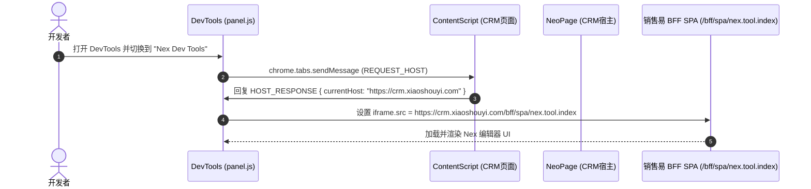
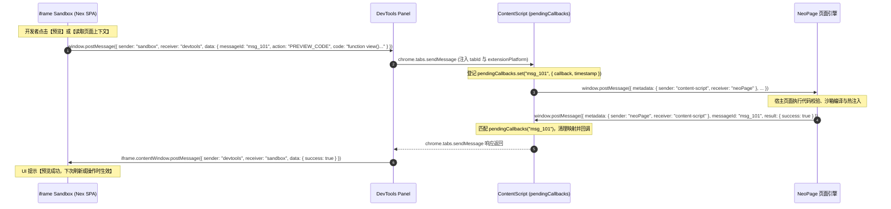

# 销售易官方 NEX 2.0 开发者工具插件 (Nex Dev Tools) 深度逆向与技术架构手册

> **分析目标**：销售易官方 Chrome 扩展插件 `Nex Dev Tools - 销售易Nex开发插件`（Nex聚合版）  
> **插件源路径**：`/Users/xiiaowu/Desktop/销售易/nex_dev_tool/`  
> **逆向引擎**：REA (Reverse Engineer Anything) Engine & AST Static Analyzer  
> **根目录指纹 (SHA-256)**：`600167242bc34d87d418ed3a26ceb2a57815071483755fec011cfaf72ac5c155`  
> **REA Evidence 存证 ID**：`ev_bc0b857cf953101fd88932f3397aa487195b1f0c32d6d3418422111c37e9f24a`  
> **REA Analysis View 存证 ID**：`ev_a288898d7dc3f829cd4aa56ac84a9d1b9685f069cbe81f8bfe69cfce285b3e57`  

---

## 目录
1. [逆向审计与工程概览](#1-逆向审计与工程概览)
   - 1.1 REA 静态分析指标与 AST 特征
   - 1.2 插件文件资产清单与 SHA-256 校验哈希
2. [插件运行架构与角色拓扑](#2-插件运行架构与角色拓扑)
   - 2.1 四层通信实体模型
   - 2.2 跨上下文通信拓扑架构图
3. [核心文件逐层逆向解析](#3-核心文件逐层逆向解析)
   - 3.1 `manifest.json`：MV3 规范与权限安全模型
   - 3.2 `core/constants.js`：全局枚举与通信常量
   - 3.3 `core/domains.js`：大客户租户白名单与域提取规则
   - 3.4 `core/config.js`：本地前端重定向机制
   - 3.5 `devtools/index.js` & `panel.js`：DevTools 宿主与网关
   - 3.6 `scripts/contentScript.js`：宿主桥接与回调状态机
   - 3.7 `scripts/serviceWorker.js`：状态栏图标动态响应
4. [核心通信协议与请求生命周期](#4-核心通信协议与请求生命周期)
   - 4.1 Host 探测与 SPA 加载时序 (`REQUEST_HOST` -> `HOST_RESPONSE`)
   - 4.2 双向消息路由协议 (Sandbox <-> DevTools <-> ContentScript <-> NeoPage)
   - 4.3 统一消息封包协议 (Message Envelope)
   - 4.4 超时清理与状态追踪机制 (`pendingCallbacks`)
5. [Nex 2.0 业务体系联动机制](#5-nex-20-业务体系联动机制)
   - 5.1 BFF SPA 端点：`/bff/spa/nex.tool.index`
   - 5.2 页面扩展与运行时沙箱规范 (`view(ctx, props)`)
   - 5.3 在线预览、版本保存与全量发布闭环
6. [开发者调试、魔改与排障指南](#6-开发者调试魔改与排障指南)
   - 6.1 开启控制台详细日志 (`nexConsole`)
   - 6.2 本地热开发联调配置 (`REACT_APP_URL`)
   - 6.3 常见故障排查表

---

## 1. 逆向审计与工程概览

### 1.1 REA 静态分析指标与 AST 特征

通过 REA (Reverse Engineer Anything) 专用 JavaScript Application Analyzer，对该扩展目录进行了完整静态语法与语义分析，提取的证据如下：

| 分析维度 | 统计值 / 证据说明 |
|:---|:---|
| **REA Evidence ID** | `ev_bc0b857cf953101fd88932f3397aa487195b1f0c32d6d3418422111c37e9f24a` |
| **Analysis View ID** | `ev_a288898d7dc3f829cd4aa56ac84a9d1b9685f069cbe81f8bfe69cfce285b3e57` |
| **Root SHA-256** | `600167242bc34d87d418ed3a26ceb2a57815071483755fec011cfaf72ac5c155` |
| **相关文件总数** | 10 个（含 HTML、JS、图片及配置文件） |
| **解析脚本文件** | 7 个原生 JavaScript 文件 |
| **文本字节数** | 8,514 Bytes |
| **遍历 AST 节点数** | 1,138 个 |
| **数据流关系 (Data-flow)** | 467 条 |
| **对象流关系 (Object-flow)** | 61 条 |
| **闭包调用关系 (Closure)** | 25 条 |
| **函数调用流 (Call-flow)** | 16 条 |
| **定时器任务 (Timer)** | 1 条（`pendingCallbacks` 超时定时清理器） |
| **全局事件监听 (Event)** | 2 条（`window.message`、`chrome.runtime.onMessage`） |

### 1.2 插件文件资产清单与 SHA-256 校验哈希

```
nex_dev_tool/
├── manifest.json                  # 0e8c2095d2f9aecb927518c2df3a27726e8fb5ffe1dae0db2dffbef7c1992e71
├── assets/
│   ├── favicon.ico                # 70c4963306f1b64d2a856a86f6c54de41471cf4e9936d124b5a04ad164d2c7d7
│   └── image/
│       ├── devLogo.png            # 90ecc6af10415561f7fd620eb30090450fbb9acc01023a5e7d4497f788eec3e2
│       ├── disabledLogo.png       # 71a78801e0926bffe212eed33df84439bdc3d1961829bd8b19ee0a55e7c82da6
│       └── logo.png               # 5eb55997f2103ca069c78e118d4e3ea22a32e802bc39a0da969074482596006c
├── core/
│   ├── constants.js               # bf1d20dd75f72effb336fde6b5c39ea580612d4e00cb920718e5530027f3450f
│   ├── domains.js                 # fd6b249a5925b38410d893d073843fa8306dbe4655672528840262cbddb68a2f
│   └── config.js                  # ec0e2f4978e44b81accd039f022e351d1672d69f0e7615ddaa8aefa67169a62d
├── devtools/
│   ├── index.html                 # de63a20e18b82a5a8cf5f19d13f9d513e491927c4db2621fa117624a0dcd0ab9
│   ├── index.js                   # 26fa3709feb256c1c64fe4ca4c17126dcecd76b4028137701eaf72ce9981f4c7
│   ├── panel.html                 # 600121a312610917a05522a7560e6f68ae8e0715d0e14a0c3d526df42a129004
│   └── panel.js                   # 770e33d7ad2a5a741959392b29617f233343007d528527aea403ef2b60f9524a
└── scripts/
    ├── contentScript.js           # 84c578371cf39ab10b8e5e91fa17367c83327a7d087cc6c1d5535ca802efe16a
    └── serviceWorker.js           # e91dd8f2cbccc73b8ed66aef7f788d4d5a746c258df5b05dc8bc046c58194685
```

---

## 2. 插件运行架构与角色拓扑

### 2.1 四层通信实体模型

通过逆向 `core/constants.js`，该插件显式抽象了 4 种系统级通信角色（`MessageSender` / `MessageReceiver`）：

```javascript
const MessageSender = {
  NEO_PAGE:       "neoPage",         // 销售易 CRM 宿主环境 (Neo UI Framework 页面上下文)
  SANDBOX:        "sandbox",         // DevTools 面板内嵌入的 iframe SPA 沙箱页面
  CONTENT_SCRIPT: "content-script",  // 注入在被调试 CRM 网页的 Content Script
  DEVTOOLS:       "devtools"         // Chrome DevTools Panel 扩展上下文
};
```

各角色的职责如下：
1. **`neoPage` (CRM 宿主)**：包含销售易当前正在运行的 CRM 页面（首页、列表页、表单页、详情页），运行 `view(ctx, props)` 脚本引擎，接收扩展注入代码并提供执行结果。
2. **`contentScript` (中继代理)**：桥接浏览器原生安全隔离，同时具备访问当前页面 DOM/`window` 和调用 `chrome.runtime` / `chrome.tabs` API 的能力，负责在 `neoPage` 与 `devtools` 之间双向转发并维护回调映射。
3. **`devtools` (管理网关)**：Chrome 开发者工具窗口，负责宿主地址嗅探、iframe 页面加载和跨上下文消息中转。
4. **`sandbox` (UI 工作台)**：实际的 Nex 2.0 Web 工作台（通常从销售易租户地址动态加载 `/bff/spa/nex.tool.index`），提供代码编辑、语法检查、版本对比、保存与预览交互界面。

### 2.2 跨上下文通信拓扑架构图

```
┌────────────────────────────────────────────────────────────────────────┐
│                        Chrome Browser Engine                           │
│                                                                        │
│  ┌─────────────────────────┐          ┌─────────────────────────────┐  │
│  │   CRM Tab (Inspected)   │          │    Chrome DevTools Window   │  │
│  │                         │          │                             │  │
│  │  ┌───────────────────┐  │          │  ┌───────────────────────┐  │  │
│  │  │    neoPage        │  │          │  │    devtools/panel.js  │  │  │
│  │  │ (Salesyi Neo UI)  │  │          │  │    (Panel Gateway)    │  │  │
│  │  └────────▲──────────┘  │          │  └──────────▲────────────┘  │  │
│  │           │             │          │             │               │  │
│  │     window.postMessage  │          │     window.postMessage      │  │
│  │           │             │          │             │               │  │
│  │  ┌────────▼──────────┐  │          │  ┌──────────▼────────────┐  │  │
│  │  │   contentScript   │  │◄─────────┼──┤    sandbox (iframe)   │  │  │
│  │  │(pendingCallbacks) │  │chrome.tabs│  │(/bff/spa/nex.tool.ind)│  │
│  │  └───────────────────┘  │.sendMessage│  └───────────────────────┘  │  │
│  └─────────────────────────┘          └─────────────────────────────┘  │
│                                                                        │
│                      ┌──────────────────────┐                          │
│                      │  scripts/            │                          │
│                      │  serviceWorker.js    │                          │
│                      │  (Tab Icon Updater)  │                          │
│                      └──────────────────────┘                          │
└────────────────────────────────────────────────────────────────────────┘
```

---

## 3. 核心文件逐层逆向解析

### 3.1 `manifest.json`：MV3 规范与权限安全模型

* **Manifest 版本**：`manifest_version: 3`，符合 Chrome 88+ 现代扩展规范。
* **开发页面注册**：`"devtools_page": "devtools/index.html"`，当用户按 F12 打开开发者工具时自动初始化。
* **脚本注入范围**：
  ```json
  "content_scripts": [
    {
      "matches": ["http://*/*", "https://*/*"],
      "js": ["core/constants.js", "scripts/contentScript.js"],
      "run_at": "document_end"
    }
  ]
  ```
  在所有 HTTP/HTTPS 页面末尾执行注入，先载入通信常量，再执行内容脚本逻辑。
* **权限清单分析**：
  - `clipboardRead`, `clipboardWrite`：支持在编辑器中复制代码、从外部粘贴代码。
  - `tabs`, `activeTab`：用于根据 `inspectedWindow.tabId` 锁定当前操作的目标页面标签。
  - `storage`：用于缓存本地首选项或 token。
  - `scripting`：支持动态向目标标签页注入代码或辅助诊断逻辑。
  - `contextMenus`：支持右键菜单扩展。

### 3.2 `core/constants.js`：全局枚举与通信常量

```javascript
const PANEL_NAME = "Nex Dev Tools",
      PANEL_ICON = "assets/image/devLogo.png",
      PANEL_PAGE = "devtools/panel.html",
      MessageSender = {
        NEO_PAGE: "neoPage",
        SANDBOX: "sandbox",
        CONTENT_SCRIPT: "content-script",
        DEVTOOLS: "devtools"
      },
      MessageReceiver = {
        NEO_PAGE: "neoPage",
        SANDBOX: "sandbox",
        CONTENT_SCRIPT: "content-script",
        DEVTOOLS: "devtools"
      },
      INIT_CONNECTION = "INIT_CONNECTION",
      REQUEST_HOST = "REQUEST_HOST",
      HOST_RESPONSE = "HOST_RESPONSE";
```

### 3.3 `core/domains.js`：大客户租户白名单与域提取规则

插件逆向发现硬编码的客户域白名单（涵盖销售易头部企业客户及本地开发环境）：

```javascript
const ALLOWED_DOMAINS = [
  "uniview.com",                        // 宇视科技
  "sany.com.cn",                        // 三一重工
  "huolala.work",                       // 货拉拉
  "pinnacle-crm.dev.ali.cloud.cn.hsbc", // 汇丰银行 (HSBC Pinnacle CRM)
  "fowo.com",                           // 福佑卡车
  "xiaoshouyi.com",                     // 销售易官方 SaaS 生产与测试域
  "shanghai-electric.com",              // 上海电气
  "health-100.cn",                      // 美年大健康
  "localhost",                          // 本地私有化开发环境
  "woa.com"                             // 腾讯办公网 / 企点集成环境
];

const DOMAIN_PATTERN = new RegExp(
  ALLOWED_DOMAINS.map((c => c.replace(".", "\\."))).join("|")
);

const getMatches = () => ["http://*/*", "https://*/*"];
```

### 3.4 `core/config.js`：本地前端重定向机制

```javascript
window.NEX_CONFIG = {
  REACT_APP_URL: ""
};
```
* **设计意图**：提供开发热插拔能力。如果设置为 `http://localhost:3000`，DevTools 面板将跳过线上 `/bff/spa/nex.tool.index`，转而加载本地正在运行的 React/Vite 开发服务器，便于对 Nex Dev Tools 面板 UI 本身进行修改与调试。

### 3.5 `devtools/index.js` & `panel.js`：DevTools 宿主与网关

#### index.js
```javascript
chrome.devtools.inspectedWindow.eval("window.location", ((o, e) => {
  e ? console.error("获取当前页面失败:", e) 
    : chrome.devtools.panels.create(PANEL_NAME, PANEL_ICON, PANEL_PAGE, (o => {
        console.log("面板创建成功");
      }));
}));
```
打开 DevTools 时，通过 `inspectedWindow.eval` 测试环境连通性，成功后调用 `panels.create` 创建 "Nex Dev Tools" 面板。

#### panel.js
1. **宿主探测 (`requestHostInfo`)**：
   ```javascript
   function requestHostInfo() {
     showLoadingState();
     const tabId = chrome.devtools.inspectedWindow.tabId;
     chrome.tabs.sendMessage(tabId, {
       sender: MessageSender.DEVTOOLS,
       receiver: MessageReceiver.CONTENT_SCRIPT,
       eventType: REQUEST_HOST
     }, (res) => {
       if (chrome.runtime.lastError) {
         console.error("请求获取host失败:", chrome.runtime.lastError);
         return showReloadButton();
       }
       if (res && res.eventType === HOST_RESPONSE && res.data && res.data.currentHost) {
         const sandbox = document.getElementById("sandbox");
         if (sandbox) {
           const targetUrl = `${res.data.currentHost}/bff/spa/nex.tool.index`;
           sandbox.src = targetUrl;
           showLoadingState();
         }
       }
     });
   }
   ```
2. **跨域桥接转发 (`window.onmessage`)**：
   ```javascript
   window.addEventListener("message", (e) => {
     if (e.data.sender === MessageSender.SANDBOX && e.data.receiver === MessageReceiver.DEVTOOLS) {
       sendMessageToContentScript({
         ...e.data.data,
         tabId: chrome.devtools.inspectedWindow.tabId,
         metadata: {
           ...e.data.data.metadata,
           extensionPlatform: "chromeExtension"
         }
       }, function(response) {
         if (response) {
           const sandbox = document.getElementById("sandbox");
           sandbox && sandbox.contentWindow && sandbox.contentWindow.postMessage({
             sender: MessageSender.DEVTOOLS,
             receiver: MessageSender.SANDBOX,
             data: response.data
           }, "*");
         }
       });
     }
   });
   ```

### 3.6 `scripts/contentScript.js`：宿主桥接与回调状态机

#### 日志系统 (`NexLogger`)
```javascript
const NexLogger = {
  isEnabled: function() {
    try {
      return localStorage.getItem("nexConsole") === "true";
    } catch(e) {
      return false;
    }
  },
  log: function(...e) {
    this.isEnabled() && console.log("[Nex]", ...e);
  },
  error: function(...e) {
    console.error("[Nex]", ...e);
  }
};
```
在目标 CRM 页面的控制台输入 `localStorage.setItem("nexConsole", "true")` 即可开启 `[Nex]` 详细网络与桥接日志。

#### 回调映射与超时清理器
```javascript
const pendingCallbacks = new Map();

// 每 60 秒检查并清理超过 30 秒无响应的请求
setInterval(() => {
  const now = Date.now();
  for (const [id, item] of pendingCallbacks.entries()) {
    if (now - item.timestamp > 30000) {
      NexLogger.log(`请求 ${id} 超时未收到响应`);
      pendingCallbacks.delete(id);
    }
  }
}, 60000);
```

#### 消息拦截与转发生命周期
1. **来自 DevTools 的请求 (`chrome.runtime.onMessage`)**：
   - 如果是 `eventType === REQUEST_HOST`，立即同步返回 `window.location.origin`。
   - 否则提取 `e.data.messageId`，加入 `pendingCallbacks`，并执行 `window.postMessage` 广播至宿主：
     ```javascript
     pendingCallbacks.set(messageId, { callback: sendResponse, timestamp: Date.now() });
     window.postMessage({
       ...e.data,
       metadata: {
         ...e.data.metadata,
         sender: MessageSender.CONTENT_SCRIPT,
         receiver: MessageSender.NEO_PAGE
       }
     }, "*");
     return true; // 保持异步通道
     ```
2. **来自 CRM 宿主页面的响应 (`window.addEventListener("message")`)**：
   - 检查 `e.source === window`。
   - 匹配 `sender === 'neoPage'` 且 `receiver === 'content-script'`。
   - 如果存在 `messageId` 且命中 `pendingCallbacks`，触发原 promise 回调：
     ```javascript
     const entry = pendingCallbacks.get(messageId);
     pendingCallbacks.delete(messageId);
     entry.callback({
       sender: MessageSender.CONTENT_SCRIPT,
       receiver: MessageReceiver.DEVTOOLS,
       data: e.data
     });
     ```
   - 否则作为页面单向事件广播，调用 `chrome.runtime.sendMessage` 发送至 DevTools。

### 3.7 `scripts/serviceWorker.js`：状态栏图标动态响应

```javascript
function setStatusBarIcon(isActive, tabId) {
  const isDev = chrome.runtime.getManifest().name.endsWith("(Dev)");
  const iconName = isActive 
    ? (isDev ? "devLogo" : "logo") 
    : (isDev ? "devLogo" : "disabledLogo");
  
  chrome.action.setIcon({
    tabId: tabId,
    path: {
      16: `../assets/image/${iconName}.png`
    }
  });
}

chrome.tabs.onUpdated.addListener((tabId, changeInfo, tab) => {
  if (changeInfo.status === "complete") {
    tab.url ? setStatusBarIcon(true, tabId) : setStatusBarIcon(false, tabId);
  }
});
```

---

## 4. 核心通信协议与请求生命周期

### 4.1 Host 探测与 SPA 加载时序



### 4.2 双向消息路由协议 (代码预览与执行)



### 4.3 统一消息封包协议 (Message Envelope)

所有流经网关的消息均符合以下封包格式：

```typescript
interface NexMessageEnvelope<T = any> {
  // 顶层传输元数据
  sender: "sandbox" | "devtools" | "content-script" | "neoPage";
  receiver: "sandbox" | "devtools" | "content-script" | "neoPage";
  eventType?: "INIT_CONNECTION" | "REQUEST_HOST" | "HOST_RESPONSE";
  
  // 业务负载
  data: {
    messageId?: string;       // 保证请求与响应一一对应的唯一随机串
    action?: string;          // 业务操作指令（如 GET_PAGE_CONTEXT, PREVIEW, SAVE）
    payload?: T;              // 具体业务参数
    metadata?: {
      sender?: string;
      receiver?: string;
      extensionPlatform?: "chromeExtension"; // 注入标识
      [key: string]: any;
    };
    [key: string]: any;
  };
}
```

---

## 5. Nex 2.0 业务体系联动机制

### 5.1 BFF SPA 端点：`/bff/spa/nex.tool.index`

逆向表明，Nex Dev Tools 扩展本身是一个**极薄的轻量化中继外壳**，其核心的代码编辑器、代码模板生成、版本管理与语法高亮（Monaco Editor）均由销售易服务端 `/bff/spa/nex.tool.index` 动态渲染提供。
这种设计带来了巨大的架构优势：
1. **多租户隔离与实时升级**：扩展不需要频繁提交 Chrome Web Store 审核，销售易服务端升级 Nex 功能，所有安装插件的开发者立即可用。
2. **免登录态透传**：因为 SPA iframe 加载于当前租户的同一顶级域（如 `https://crm.xiaoshouyi.com`），直接天然继承 CRM 登录态 Cookie 与会话，无需插件单独实现复杂的 OAuth2 授权。

### 5.2 页面扩展与运行时沙箱规范 (`view(ctx, props)`)

Nex 2.0 的业务开发核心函数签名：

```javascript
function view(ctx, props) {
    return {
        type: "EntityForm", // 扩展类型：EntityForm | neoUIFramework | EntityList | EntityDetail
        layoutExtension: {
            afterFrameworkLoad: function() {
                // 页面级生命周期钩子
            }
        },
        componentExtensions: {
            entityForm: {
                afterRender: function(e) {
                    // 表单渲染后钩子
                },
                entityFormMaster: {
                    formItem: [
                        {
                            scope: { itemApiKey: "fieldName__c" },
                            label: "显示名称",
                            required: true,
                            disabled: false,
                            visible: true,
                            onChange: function(e) {
                                // 字段值变动联动
                            }
                        }
                    ]
                }
            }
        }
    };
}
```

* **`ctx` 全局对象核心能力**：
  - `ctx.api.request(options)`：跨域安全封装的 REST 数据请求，自动携带 CRM 会话。
  - `ctx.api.log(...)` / `ctx.util.log(...)`：运行时安全日志输出。
  - `ctx.ui.showToast(type, msg)`：页面轻提示（`success`, `error`, `warning`）。
  - `ctx.user`：当前登录用户、部门及租户信息。
* **`props` 与组件定位方法**：
  - `props.getComponent(name, scope, matchAllSubordinates)`：定位页面内单个特定组件。
  - `props.getAllComponents(name, scope, matchAllSubordinates)`：获取符合条件的组件实例集合。

### 5.3 在线预览、版本保存与全量发布闭环

1. **新建扩展**：用户进入任意 CRM 页面并打开 Nex Dev Tools，插件通过 `REQUEST_HOST` 握手，初始化 SPA，根据当前页面 URL 自动推断当前对象与页面类型，生成代码骨架。
2. **热预览 (Preview)**：点击“预览”按钮，代码通过跨进程消息通道直接下发至当前页面的 `neoPage` 内存中注册。当下一次触发对应事件或刷新页面时，立即执行当前规则。
3. **版本保存 (Save)**：点击“保存”，SPA 调用销售易后端接口，生成带有递增版本号的配置草稿。
4. **全量发布 (Publish)**：点击“启用”，将指定版本的 Nex 代码打标为全租户生效。

---

## 6. 开发者调试、魔改与排障指南

### 6.1 开启控制台详细日志 (`nexConsole`)

在 CRM 页面的开发者工具 Console 中运行：

```javascript
// 开启 Nex 插件 ContentScript 级转发日志
localStorage.setItem("nexConsole", "true");

// 开启销售易 Nex 2.0 运行时全局日志
localStorage.setItem("logger", "true");
localStorage.setItem("neoConsole", "true");
```
开启后，可以在 Console 中清晰观测到 `[Nex]` 开头的请求分发、Pending Callback 注册与响应回收过程。若需关闭，只需调用 `localStorage.removeItem("nexConsole")` 即可。

### 6.2 本地热开发联调配置 (`REACT_APP_URL`)

若需要为销售易二次开发自己的 DevTools 界面或本地调试 SPA：
1. 打开 `/Users/xiiaowu/Desktop/销售易/nex_dev_tool/core/config.js`；
2. 修改 `REACT_APP_URL`：
   ```javascript
   window.NEX_CONFIG = {
     REACT_APP_URL: "http://localhost:3000"
   };
   ```
3. 重新加载扩展程序，此时 DevTools 面板将直接加载本地开发服务器。

### 6.3 常见故障排查表

| 现象 | 根因分析 | 解决方案 |
|:---|:---|:---|
| **DevTools 显示“无法获取当前页面信息”** | `REQUEST_HOST` 请求超时（超过 30 秒）或 ContentScript 注入失败 | 确认当前标签页是否已加载完毕；刷新页面并重新点击面板上的【重新加载】按钮。 |
| **点击“预览”后控制台无任何反应** | 1. 语法检查未通过；<br>2. 宿主未开启日志；<br>3. `nexConsole` 未开启 | 1. 检查代码合法性（如 `view` 函数返回值）；<br>2. 在控制台执行 `localStorage.setItem("nexConsole", "true")`；<br>3. 刷新页面重新测试。 |
| **白名单之外的私有化环境无法加载** | 插件内嵌域名虽有 `ALLOWED_DOMAINS`，但实际 `manifest.json` 拥有 `<all_urls>` 通配权限 | 检查私有化部署环境下 `/bff/spa/nex.tool.index` 服务是否开启；可修改 `core/config.js` 强制指定 SPA 宿主。 |
| **多 Tab 调试时消息错乱** | `panel.js` 使用 `chrome.devtools.inspectedWindow.tabId` 严格隔离了标签 | 确保在当前被调试的目标标签页窗口打开对应的 DevTools，切勿跨标签调试。 |
